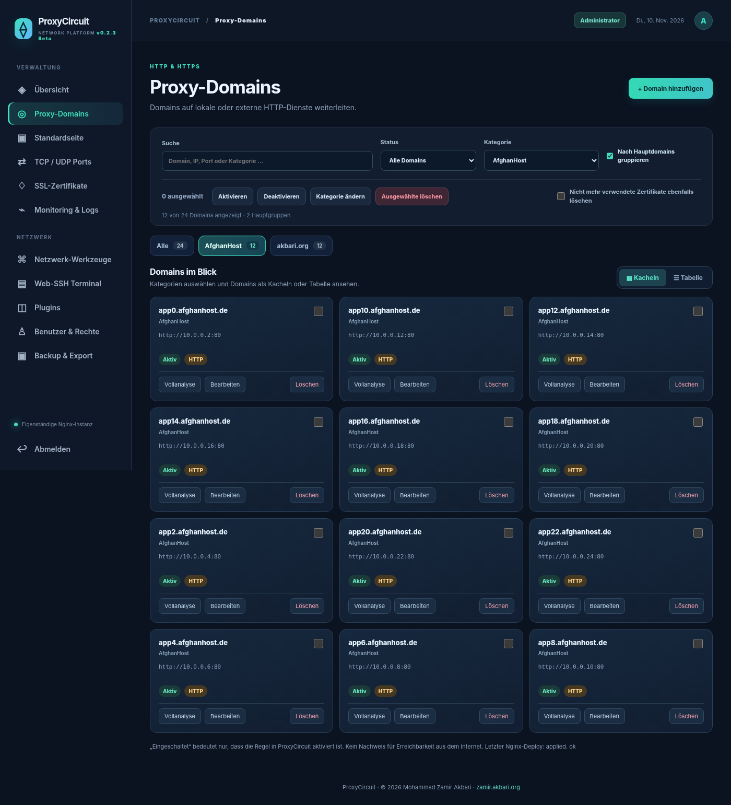
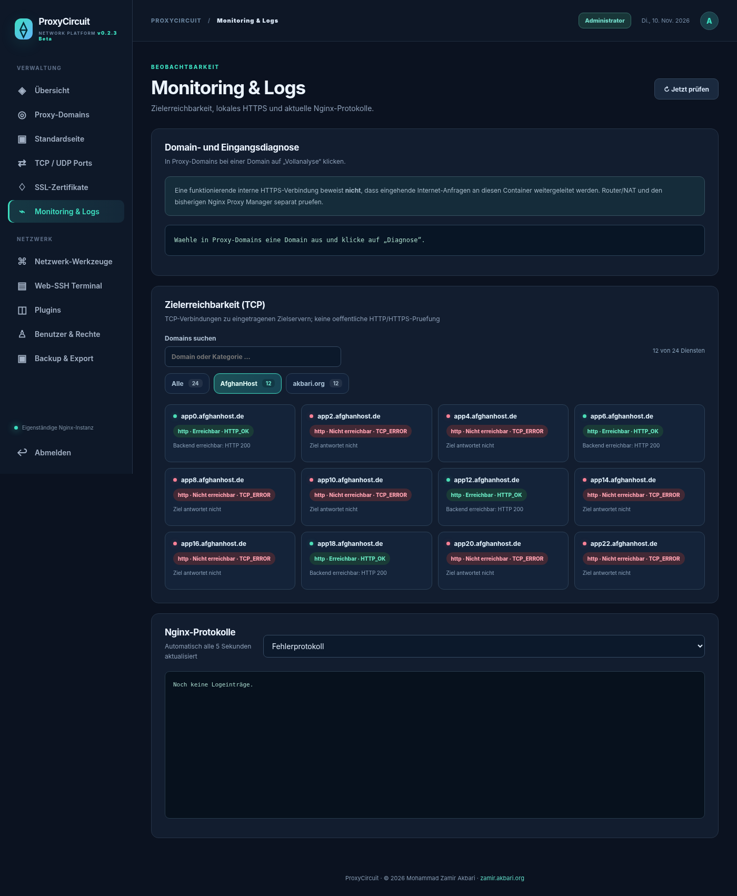
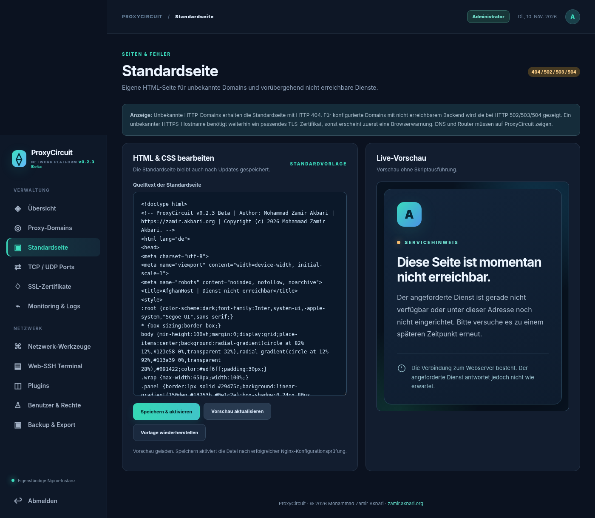
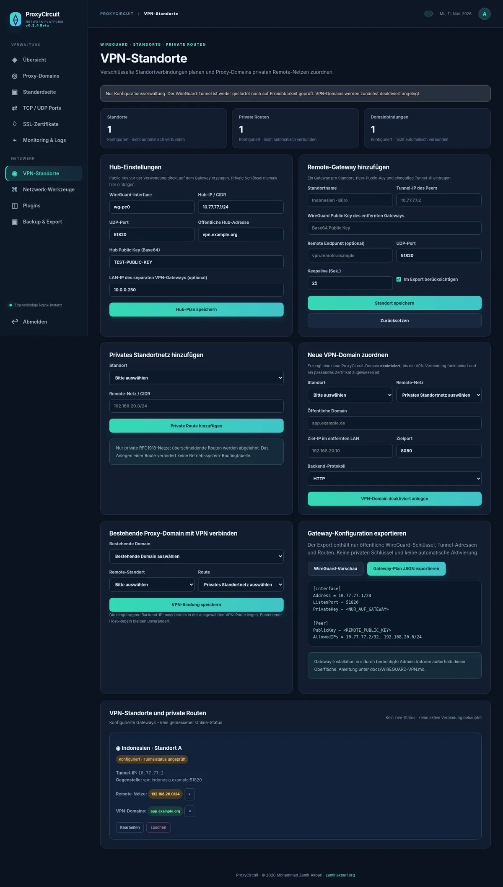

**Sprache / Language:** [**Deutsch**](README.de.md) | [**English**](README.md)

# ProxyCircuit

**Selbst gehostete Reverse-Proxy- und Netzwerkverwaltungsplattform** · **v0.2.6-beta** · Öffentliches Pre-release

[](https://github.com/zamir93/ProxyCircuit/actions/workflows/ci.yml) · [**v0.2.6 Beta herunterladen**](https://github.com/zamir93/ProxyCircuit/releases/tag/v0.2.6-beta)

**Autor und Copyright:** Mohammad Zamir Akbari · [zamir.akbari.org](https://zamir.akbari.org) · © 2026



ProxyCircuit ist eine eigenständige Verwaltungsplattform für **NGINX-basierte Reverse Proxys**, HTTP/HTTPS-Domains, TCP/UDP-Weiterleitungen und TLS-Zertifikate. Sie bietet rollenbasierte Zugriffe, Domain-Diagnosen, Web-SSH, Netzwerk-Werkzeuge, mobile Ansichten und eine editierbare HTML-Standardseite für HTTP-Fehler.

> **Beta-Version:** Zuerst in einer isolierten Umgebung testen, vor Updates Konfigurationen sichern und den Verwaltungszugang absichern. Ein grüner CI-Test ist kein vollständiges Sicherheits-Audit. Die Veröffentlichung auf GitHub verändert keine vorhandene ProxyCircuit-Installation.

## Neu in v0.2.6 Beta

- **TCP/UDP-Bind-IP pro Regel:** Bestimmte lokale IPv4-/IPv6-Adressen oder Wildcard-Adressen auswählen; bestehende Regeln bleiben bei der Migration erhalten. Derselbe Port ist auf getrennten, nicht überlappenden lokalen IP-Adressen möglich.
- **Portkonflikt-Diagnose:** Erkennung von Wildcards, IPv6-Überlappungen, bestehenden Regeln und fremden Prozessen. Fremde Dienste werden nicht beendet.
- **Sicherere NGINX-Aktivierung:** Isolierte Syntaxprüfung, Konfigurations-Snapshots, atomare Übernahme, Prüfung der Worker und Listener nach Reload sowie Wiederherstellungsversuch bei Aktivierungsfehlern.
- **TLS-/SNI-Prüfung:** Tatsächlich ausgeliefertes HTTPS-Zertifikat kontrollieren – einschließlich SAN, Ablaufdatum und SHA-256-Fingerabdruck. HTTP 401 kann ein erreichbares, aber geschütztes Backend bedeuten.
- **Diagnose & Monitoring:** Backend-Erreichbarkeit, NGINX-Status, TCP/UDP-Porttests sowie Konfigurationshistorie und Diffs.
- **Optionale Administrator-MFA:** TOTP-Zwei-Faktor-Anmeldung mit Schutz vor Wiederverwendung eines Einmalcodes.
- **NGINX-/HTTP/2-Kompatibilität:** Passende Syntax für ältere und neuere NGINX-Versionen; die zuvor fehlgeschlagenen GitHub-Actions-Tests wurden korrigiert.
- **Vorhandene Funktionen bleiben erhalten:** Domains, Zertifikate, Upstream-Zielpfade, Benutzer, Portregeln und WireGuard-Konfigurationsverwaltung.

**Teststatus:** Der GitHub-Actions-Lauf **Tests / Build #14** war für Commit [`87180a4`](https://github.com/zamir93/ProxyCircuit/commit/87180a4) erfolgreich. Lokal wurden **123 Python-Tests** bestanden. Ein vollständiger End-to-End-Test auf einem neuen Produktivsystem ist dadurch nicht ersetzt.

Dokumentation: [Update, Test und Rollback](docs/UPDATE-0.2.6.md) · [Technischer Changelog](CHANGELOG-0.2.6.md) · [Testbericht](docs/TESTBERICHT-0.2.6.md) · [Roadmap](docs/ROADMAP.md)

## Screenshots

| Domain-Kategorien | Monitoring | Standardseiten-Editor |
| --- | --- | --- |
|  |  |  |

**Mobil:** [Domain-Tabs](docs/screenshots/mobile-tabs.png) · [Domain-Kacheln](docs/screenshots/mobile-domains.png) · [HTML-Editor](docs/screenshots/mobile-default-editor.png)

*Die Screenshots zeigen simulierte Demo-Daten; keine realen Server- oder Nutzerdaten.*

## Funktionsumfang

- HTTP/HTTPS-Reverse-Proxy, TLS-Zertifikatsverwaltung und SNI für interne HTTPS-Ziele.
- Domain-Gruppen, Kategorien, Kachelansicht, Massenaktionen und Domain-Vollanalyse.
- TCP/UDP-Streams, lokale Bind-Adressen, Netzwerkstatus und Rollen für Administrator/Bearbeiter/Leser.
- Web-SSH mit Hostkey-Bestätigung sowie CIDR-Konverter, IP-/Port-Scanner, mDNS, Wake-on-LAN und Forward-Proxy-Diagnose.
- Editierbare HTML-Standard-/Fehlerseite: 404 für unbekannte Hosts (nach gegebenenfalls erfolgreichem TLS-Handshake), 502/503/504 für nicht erreichbare Backends.
- SQLite für interne Verwaltungsdaten, NGINX als Reverse Proxy und Python/FastAPI für die HTTPS-Administration.
- WireGuard-Verwaltung für Standorte/Peers und private Routen einschließlich lesender Vorprüfungen. **Diese Version aktiviert keine VPN-Tunnel automatisch und verändert keine Gateway-Firewall- oder Routingregeln.**

## Schnellstart – Debian 12/13 mit systemd

Auf einem **separaten, leeren** Debian-12/13-Server oder Debian-LXC den Installer als `root` **im Zielsystem**, nicht auf dem Proxmox-Host, starten:

```bash
bash scripts/install-debian.sh
```

Nach einer nichtinteraktiven Installation einen Administrator erstellen und die API kontrollieren:

```bash
rpmgr-admin create-admin --user admin
curl -ksS https://127.0.0.1:9443/api/version
```

Vor dem Update einer bestehenden Installation zuerst geprüfte Snapshots/Backups von Datenbank, Konfiguration und Zertifikaten anlegen. Der erste Befehl prüft nur, der zweite aktualisiert und darf **nicht ungeprüft** ausgeführt werden:

```bash
bash scripts/update-debian.sh --check
# Erst nach Backup, Tests und ausdrücklicher Freigabe:
bash scripts/update-debian.sh --apply
```

Siehe [vollständige Debian-/Linux-Anleitung](docs/LINUX.md) und [Update-Anleitung für v0.2.6](docs/UPDATE-0.2.6.md).

## Schnellstart – Docker Compose auf Linux (experimentell)

```bash
docker compose build
docker compose up -d
docker compose exec -it proxycircuit \
  runuser -u rpmgr -- /opt/rpmgr/venv/bin/python -m app.cli create-admin --user admin
```

Das allgemeine Compose-Profil veröffentlicht TCP-Port **80 und 443**. Die Verwaltung ist standardmäßig ausschließlich an die **Loopback-Adresse des Docker-Hosts** `127.0.0.1:9443` gebunden. Für Fernzugriffe SSH-Tunnel oder VPN einsetzen. Der vollständige Docker-Betrieb wurde in der Build-Umgebung nicht Ende-zu-Ende getestet.

Für einen **isolierten Smoketest**, ohne die Host-Ports 80/443 freizugeben:

```bash
docker compose -p pc-v026-smoke -f compose.v026-smoke.yaml build
docker compose -p pc-v026-smoke -f compose.v026-smoke.yaml up -d
curl -ksS https://127.0.0.1:19446/api/version
```

Mehr dazu in der [Docker-Anleitung](docs/DOCKER.md).

## Unterstützte Installationsumgebungen

| Umgebung | Status | Voraussetzungen |
| --- | --- | --- |
| Debian 12/13 mit systemd, auch LXC | Nativer Installer vorhanden | Root-Rechte, freie TCP-Ports 80/443, Netzwerkzugriff, Backups |
| Docker Compose v2 unter Linux | Experimentell | Docker Engine, Compose v2, benötigte freie Host-Ports |
| Andere Linux-Distributionen ohne systemd | Keine native Unterstützung | Anpassungen erforderlich |

## Repository-Struktur

```text
ProxyCircuit/
├── app/                     # FastAPI, Datenmodell, NGINX-Renderer, Web-UI
├── docker/                  # Docker-Image und Laufzeit-Helfer
├── compose.yaml             # Docker-Volumes und Host-Ports
├── scripts/                 # Debian-/LXC-Installation, Updates, Backups
├── tools/                   # Migration und VPN-Vorprüfungen
├── tests/                   # Automatisierte Tests
├── docs/                    # Technische Anleitungen und Demo-Screenshots
├── .github/workflows/       # GitHub Actions und Docker-Build
├── CHANGELOG.md
├── RELEASE_NOTES.md
├── SECURITY.md
├── README.de.md             # Deutsche Dokumentation
├── README.en.md             # Englische Kopie
└── README.md                # Englische Standard-README
```

## Entwicklung und Tests

```bash
python3 -m venv .venv
. .venv/bin/activate
pip install -r requirements.txt pytest httpx
python -m pytest -q
```

`RPMGR_DEV=1` ist **nur** für lokale Entwicklungs- und Testumgebungen vorgesehen. Die CI-Pipeline prüft zusätzlich Python-, Bash- und JavaScript-Syntax und baut ein Docker-Image, ohne es bereitzustellen.

## WireGuard-VPN-Verwaltung und Roadmap

Der Bereich **VPN-Standorte** verwaltet Hubs/Peers, private CIDR-Routen und Remote-Proxy-Domains. Private Schlüssel verbleiben auf separaten Gateways. Neue VPN-Domain-Zuordnungen bleiben zunächst deaktiviert; es erfolgt keine automatische Tunnel- oder Routing-Aktivierung.

Lesende VPN-Vorprüfungen erkennen überlappende lokale und entfernte Subnetze und erstellen einen SHA-256-Fingerabdruck der Konfiguration. Eine separate Gateway-CLI kann Routen und Listener überprüfen, ohne Firewall oder Tunnel zu ändern. VPN-Clients für Windows/Linux/Android und Gateway-Automatisierung sind **geplant, aber nicht Bestandteil dieses Releases**.

[WireGuard-VPN-Anleitung](docs/WIREGUARD-VPN.md) · [VPN-Vorprüfungen](docs/VPN-PREFLIGHT-0.2.5.md) · [Roadmap](docs/ROADMAP.md)



[Mobile VPN-Ansicht](docs/screenshots/vpn-sites-mobile.webp)

## Sicherheit, Datenschutz und Lizenz

- Die bereinigte Quellcode-Veröffentlichung enthält **keine** produktiven Datenbanken, Zugangsdaten, privaten Schlüssel oder realen TLS-Zertifikate. Neue Installationen legen eigene Daten an; der Administrator wird separat eingerichtet.
- Den Verwaltungsport `9443` nicht ungeschützt aus dem Internet zugänglich machen. Firewall, VPN und/oder SSH-Tunnel nutzen.
- Netzwerk-Scanner und Diagnosefunktionen nur in eigenen beziehungsweise autorisierten Netzen verwenden.
- Vor Updates SQLite-Datenbank, Konfiguration, Zertifikate und Docker-Volumes sichern.
- Das öffentliche Repository ist **nicht automatisch Open Source**: Die bestehende Lizenzmitteilung gewährt keine allgemeinen Änderungs- oder Weiterverbreitungsrechte. Siehe [LICENSE-NOTICE.md](LICENSE-NOTICE.md).

[Sicherheitsrichtlinie](SECURITY.md) · [Release-Hinweise](RELEASE_NOTES.md) · [Alle Releases](https://github.com/zamir93/ProxyCircuit/releases)

---

**Entwickler / Rechteinhaber:** [Mohammad Zamir Akbari](https://zamir.akbari.org) · © 2026 · Alle Rechte vorbehalten, sofern nicht ausdrücklich anders lizenziert.
