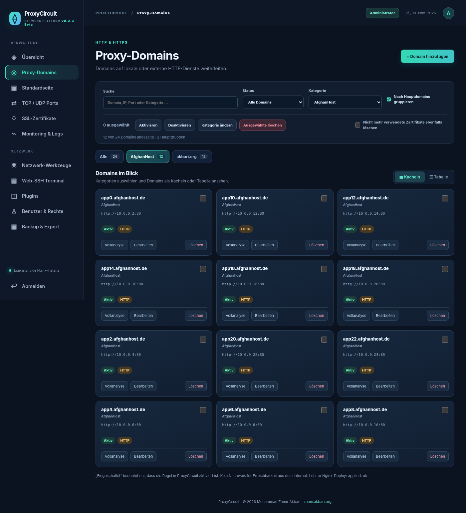
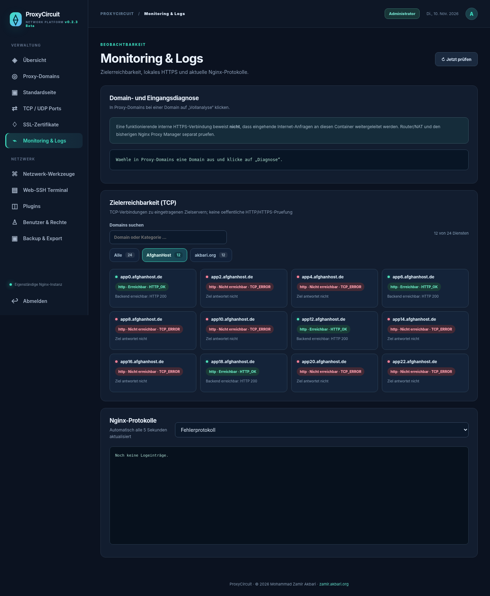
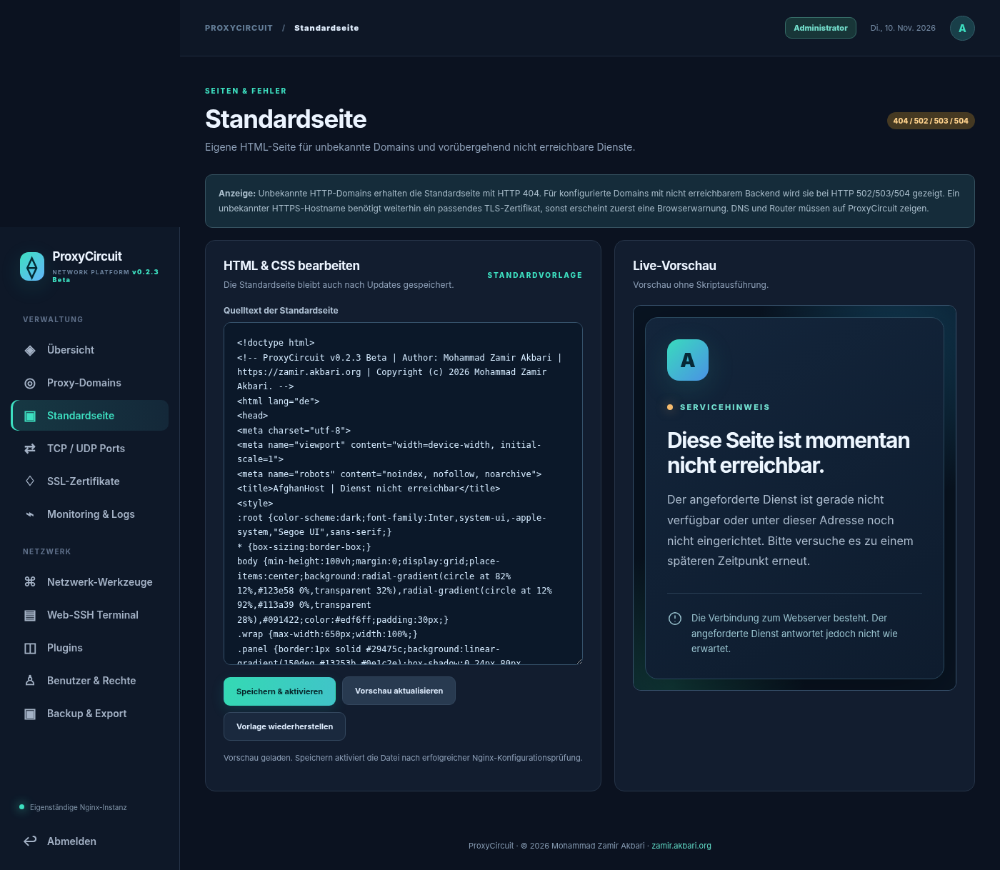
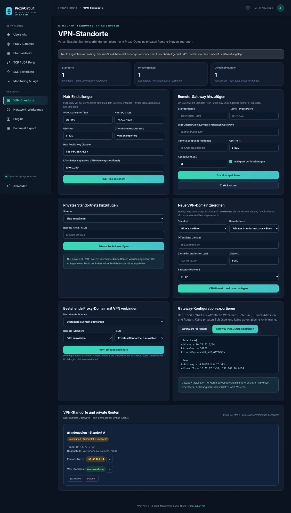

**Language / Sprache:** [**English**](README.md) | [**Deutsch**](README.de.md)

# ProxyCircuit

**Self-hosted Reverse Proxy & Network Management Platform** · **v0.2.6-beta** · Public pre-release

[](https://github.com/zamir93/ProxyCircuit/actions/workflows/ci.yml) · [**Download v0.2.6 Beta**](https://github.com/zamir93/ProxyCircuit/releases/tag/v0.2.6-beta)

**Author and copyright:** Mohammad Zamir Akbari · [zamir.akbari.org](https://zamir.akbari.org) · © 2026



ProxyCircuit is a self-hosted management platform for **NGINX-based reverse proxies**, HTTP/HTTPS domains, TCP/UDP forwarding and TLS certificates. It provides role-based access, domain diagnostics, browser-based SSH, network utilities, responsive interfaces and a customizable HTML fallback page for HTTP errors.

> **Beta release:** Test in an isolated environment, back up your configuration before an upgrade and restrict access to the administration interface. A passing CI build is not a production security audit. Publishing this repository does not modify an existing ProxyCircuit installation.

## What's new in v0.2.6 Beta

- **Per-rule TCP/UDP bind address:** Select a specific local IPv4/IPv6 address or a wildcard address. Existing rules are migrated without discarding them. The same port may be used on separate, non-overlapping local IP addresses.
- **Port conflict diagnostics:** Detect wildcard and IPv6 overlap, existing rules and foreign processes. The system reports conflicts; it does not stop unrelated services.
- **Safer NGINX deployment:** Isolated configuration preflight, snapshots, atomic configuration updates, worker and listening-socket verification after reload, and rollback attempts if activation fails.
- **TLS and SNI inspection:** Inspect the certificate actually served by an HTTPS destination, including subject alternative names (SAN), expiry and SHA-256 fingerprint. An HTTP 401 response may indicate an accessible, authentication-protected backend.
- **Diagnostics and monitoring:** Backend availability, NGINX status, TCP/UDP connectivity checks and configuration history/diffs.
- **Optional administrator MFA:** TOTP-based second-factor authentication with one-time-code replay protection.
- **NGINX HTTP/2 compatibility:** Supports the appropriate HTTP/2 syntax for older and newer NGINX versions. The previously failing GitHub Actions tests were fixed.
- **Existing functionality retained:** Domains, certificates, upstream paths, users, forwarding rules and WireGuard configuration management.

**Release validation:** The GitHub Actions **Tests / Build #14** run passed on commit [`87180a4`](https://github.com/zamir93/ProxyCircuit/commit/87180a4). Local verification reported **123 passing Python tests**. This does not replace an independent end-to-end deployment test.

Documentation: [Upgrade, testing and rollback](docs/UPDATE-0.2.6.md) (German) · [Changelog](CHANGELOG-0.2.6.md) (German) · [Test report](docs/TESTBERICHT-0.2.6.md) (German) · [Product roadmap](docs/ROADMAP.md) (German)

## Screenshots

| Domain categories | Monitoring | HTML fallback editor |
| --- | --- | --- |
|  |  |  |

**Mobile views:** [Tabs](docs/screenshots/mobile-tabs.png) · [Domain cards](docs/screenshots/mobile-domains.png) · [Fallback editor](docs/screenshots/mobile-default-editor.png)

*Screenshots contain simulated demonstration data, not private server or user information.*

## Features

- HTTP/HTTPS reverse proxies, TLS certificate management and SNI for HTTPS upstreams.
- Domain groups, categories, dashboard cards, bulk actions and domain diagnostics.
- TCP/UDP streams, local listener addresses, network status and administrator/editor/reader roles.
- Web SSH with host-key confirmation; CIDR converter, IP/port scanners, mDNS, Wake-on-LAN and forward-proxy diagnostics.
- Editable HTML error/fallback page. Unknown hosts return 404 after any necessary TLS handshake; unavailable upstreams can produce 502/503/504.
- SQLite for internal configuration data, NGINX for proxying and Python/FastAPI for the HTTPS administration interface.
- WireGuard site/peer and private route configuration, with read-only readiness checks. **This release does not automatically activate VPN tunnels or change gateway firewall/routing settings.**

## Quick start — Debian 12/13 with systemd

Use a **fresh, separate** Debian 12/13 server or Debian LXC container. Run the installer as `root` **inside the intended Linux system**, not on the Proxmox host:

```bash
bash scripts/install-debian.sh
```

Create an administrator after a non-interactive installation and check the API:

```bash
rpmgr-admin create-admin --user admin
curl -ksS https://127.0.0.1:9443/api/version
```

Before upgrading an existing installation, create a tested snapshot/backup of the database, configuration and certificates. The first command only checks; the second performs the upgrade and **must not be run without preparation**:

```bash
bash scripts/update-debian.sh --check
# After backup, testing and explicit approval:
bash scripts/update-debian.sh --apply
```

See the [complete Debian/Linux instructions](docs/LINUX.md) (German) and [v0.2.6 upgrade guide](docs/UPDATE-0.2.6.md) (German).

## Quick start — Docker Compose on Linux (experimental)

```bash
docker compose build
docker compose up -d
docker compose exec -it proxycircuit \
  runuser -u rpmgr -- /opt/rpmgr/venv/bin/python -m app.cli create-admin --user admin
```

The standard Compose example publishes TCP ports **80 and 443**. Its administration interface is bound only to the **Docker host's loopback address** at `127.0.0.1:9443`; use an SSH tunnel or VPN for remote administration. The Docker deployment has not been fully validated end-to-end in this build environment.

For an **isolated smoke test** without publishing host ports 80/443:

```bash
docker compose -p pc-v026-smoke -f compose.v026-smoke.yaml build
docker compose -p pc-v026-smoke -f compose.v026-smoke.yaml up -d
curl -ksS https://127.0.0.1:19446/api/version
```

See [Docker documentation](docs/DOCKER.md) (German).

## Supported installation environments

| Environment | Status | Requirements |
| --- | --- | --- |
| Debian 12/13, systemd, including LXC | Native installer available | Root access, free TCP 80/443 ports, network connectivity, backups |
| Docker Compose v2 on Linux | Experimental | Docker Engine, Compose v2, appropriate free host ports |
| Other Linux distributions without systemd | Not supported as a native installation | Platform-specific changes required |

## Repository layout

```text
ProxyCircuit/
├── app/                     # FastAPI, data model, NGINX renderer, web UI
├── docker/                  # Docker image and runtime helpers
├── compose.yaml             # Docker volumes and host ports
├── scripts/                 # Debian/LXC installation, updates, backups
├── tools/                   # Migration and VPN preflight utilities
├── tests/                   # Automated regression and integration tests
├── docs/                    # Technical guides and demonstration screenshots
├── .github/workflows/       # GitHub Actions tests and Docker build
├── CHANGELOG.md
├── RELEASE_NOTES.md
├── SECURITY.md
├── README.de.md             # German documentation
├── README.en.md             # English-language alias
└── README.md                # English default README
```

## Development and testing

```bash
python3 -m venv .venv
. .venv/bin/activate
pip install -r requirements.txt pytest httpx
python -m pytest -q
```

`RPMGR_DEV=1` is intended **only for local development and testing**. The CI pipeline also checks Python, shell and JavaScript syntax and builds a Docker image without deploying it.

## WireGuard VPN configuration and roadmap

The **VPN Sites** interface manages hubs/peers, private CIDR routes and remote proxy domain mappings. Private keys must remain on separate gateways. New VPN domain mappings start disabled; no automatic VPN tunnel or routing activation occurs.

Read-only VPN preflight checks detect local/remote subnet overlaps and compute a configuration SHA-256 fingerprint. A separate gateway preflight utility can inspect routes and listeners without applying firewall or tunnel changes. Windows/Linux/Android VPN clients and gateway automation are planned features, **not part of this release**.

[WireGuard VPN guide](docs/WIREGUARD-VPN.md) (German) · [Readiness checks](docs/VPN-PREFLIGHT-0.2.5.md) (German) · [Roadmap](docs/ROADMAP.md) (German)



[Mobile VPN site view](docs/screenshots/vpn-sites-mobile.webp)

## Security, privacy and licensing

- A clean source distribution does **not** include production databases, credentials, private keys or real TLS certificates. New installations initialize their own data and require administrator setup.
- Do not expose the administration port `9443` directly to the public Internet. Use appropriate firewall rules, VPN access and/or SSH tunnels.
- Run network scanning and diagnostic tools only on networks you are authorized to test.
- Back up SQLite databases, configuration, certificates and Docker volumes before upgrades.
- The public repository is **not automatically open-source licensed**: no redistribution or modification license has been granted in the current notice. See [LICENSE-NOTICE.md](LICENSE-NOTICE.md).

[Security policy](SECURITY.md) · [Release notes](RELEASE_NOTES.md) · [All releases](https://github.com/zamir93/ProxyCircuit/releases)

---

**Developer / Copyright holder:** [Mohammad Zamir Akbari](https://zamir.akbari.org) · © 2026 · All rights reserved unless otherwise licensed.
