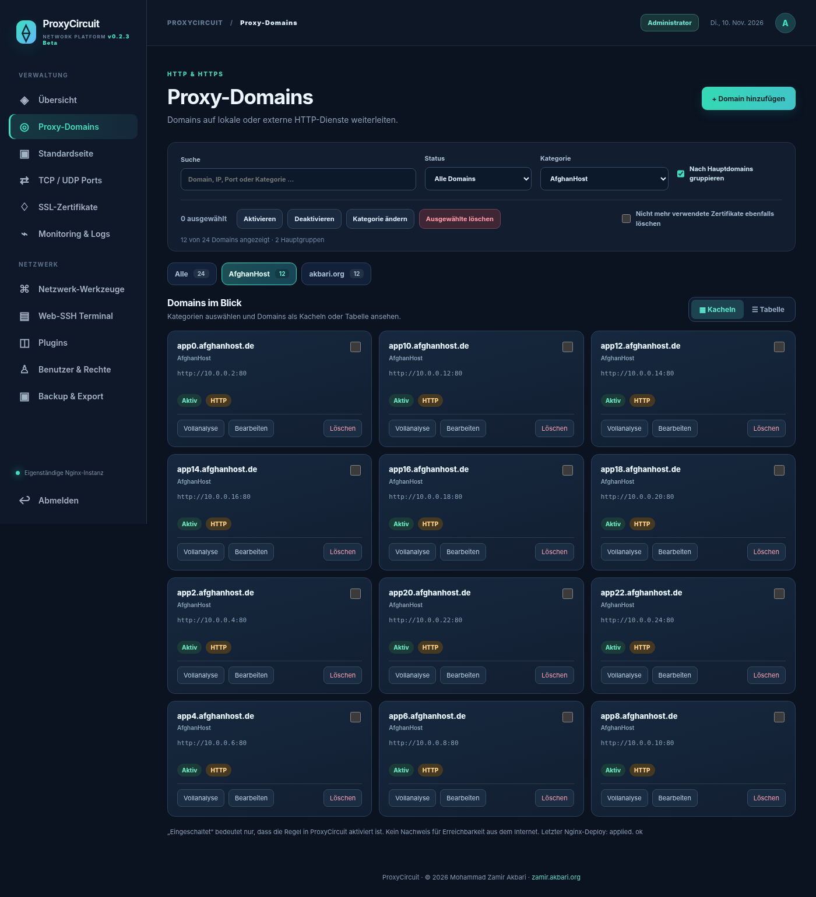

# ProxyCircuit — Reverse Proxy & Network Platform

**v0.2.3-beta** — Source-available public beta package.

Author and copyright: **Mohammad Zamir Akbari**, [zamir.akbari.org](https://zamir.akbari.org), © 2026.

ProxyCircuit is a self-hosted Nginx reverse proxy manager with HTTP/HTTPS virtual hosts, TLS certificate management, TCP/UDP forwarding, per-domain diagnostics, role-based access, Web SSH, LAN utilities, and a customizable HTML error page.

## Install options

**Debian 12/13 with systemd (standalone server or LXC):** `bash scripts/install-debian.sh`. This requires root and exclusive access to ports 80/443. See [Linux guide](docs/LINUX.md).

**Docker Compose on Linux (experimental, not end-to-end tested here):** `docker compose build && docker compose up -d`. The admin panel is bound only to the Docker host's localhost:9443 by default; create an admin account with the command in the [Docker guide](docs/DOCKER.md).

**Screenshots:** [Domain categories](docs/screenshots/domains.png) · [Monitoring](docs/screenshots/monitoring.png) · [Fallback HTML editor](docs/screenshots/default-page-editor.png) · [Mobile](docs/screenshots/mobile-domains.png). Captures use simulated demo data.

## Security & release status

This is a **beta** requiring backups, network restrictions, and real-world testing before production use. No production credentials, databases, or private keys are included. An open-source license has **not yet been chosen**; see [license notice](LICENSE-NOTICE.md).

[German README](README.md) · [Release notes](RELEASE_NOTES.md) · [Security](SECURITY.md) · [GitHub publishing](docs/GITHUB_PUBLISH.md)
