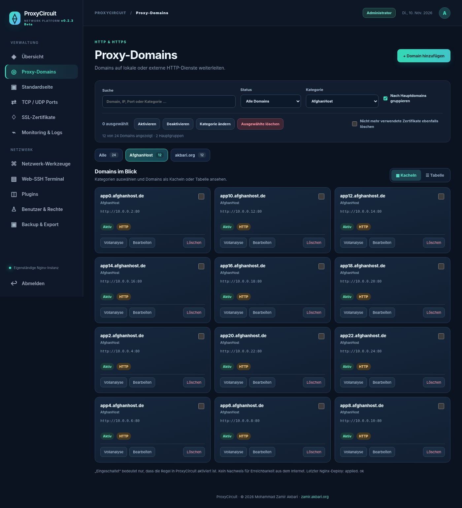
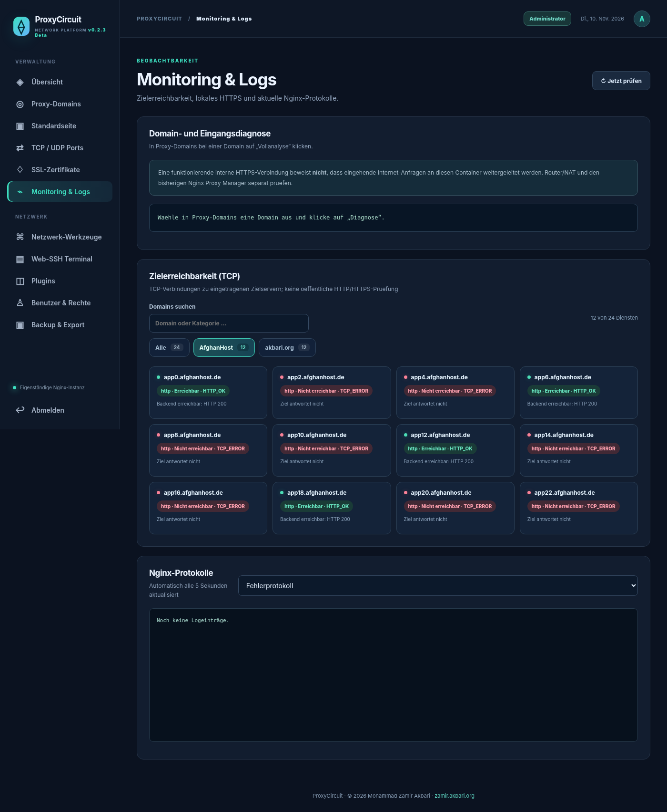
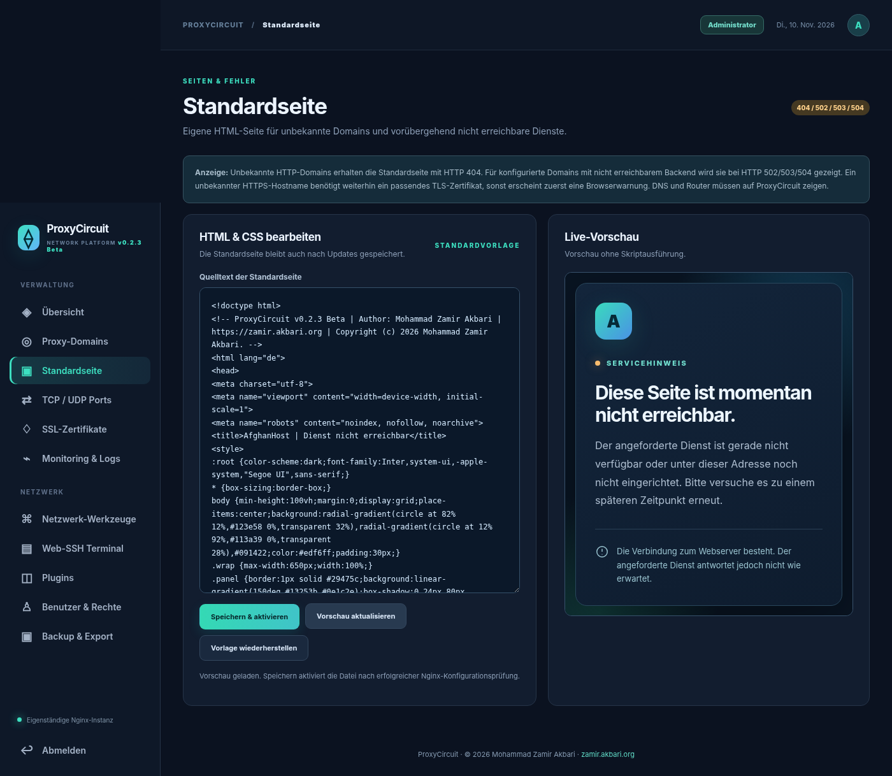

# ProxyCircuit

**Self-hosted Reverse Proxy & Network Platform** · **v0.2.3-beta** · GitHub-Beta

**Autor und Copyright:** Mohammad Zamir Akbari · [zamir.akbari.org](https://zamir.akbari.org) · © 2026



ProxyCircuit ist eine eigenständige Verwaltungsplattform für **Nginx-basierte Reverse Proxys**, HTTP/HTTPS-Domains, TCP/UDP-Weiterleitungen und Zertifikate. Enthalten sind Rollen, Domain-Diagnosen, Web-SSH, Netzwerk-Werkzeuge, mobile Oberflächen und eine editierbare HTML-Standardseite bei 404/502/503/504.

> **Öffentliche Beta:** Auf Testsystemen prüfen und vor Produktiveinsatz sichern. Kein allgemeines Security-Audit. Der GitHub-Quellcode ersetzt nicht die bestehende, bereits eingerichtete Produktivinstallation.

## Screenshots

| Domain-Kategorien | Monitoring | Standardseiten-Editor |
| --- | --- | --- |
|  |  |  |

**Mobil:** [Domain-Tabs](docs/screenshots/mobile-tabs.png) · [Domain-Kacheln](docs/screenshots/mobile-domains.png) · [HTML-Editor](docs/screenshots/mobile-default-editor.png)

*Die Screenshots zeigen simulierte Demo-Daten; keine realen Server- oder Nutzerdaten.*

## Funktionsumfang

- HTTP/HTTPS-Reverse-Proxy und SSL/TLS-Zertifikatsverwaltung, TLS-SNI für interne HTTPS-Dienste.
- Domain-Gruppen, Kategorien und Kachelansicht, Massenaktionen, Domain-Vollanalyse.
- Netzwerkstatus, TCP/UDP-Stream-Ports, Rollen für Administrator/Bearbeiter/Leser.
- Web-SSH mit Hostkey-Bestätigung sowie CIDR-Konverter, IP-/Port-Scanner, mDNS, Wake-on-LAN und Forward-Proxy-Diagnose.
- Standard-/Fehlerseite als HTML im Admin-Panel editierbar; 404 für unbekannte Hosts (nach erfolgreicher TLS-Verbindung) und 502/503/504 für ausgefallene Upstreams.
- SQLite für die internen Verwaltungsdaten, Nginx für den Reverse Proxy, Python/FastAPI für die HTTPS-Administration.

## Schnellstart – Debian 12/13 mit systemd

Auf einem **separaten, leeren** Debian-Server oder Debian-LXC (nicht auf dem Proxmox-Host) als `root`:

```bash
bash scripts/install-debian.sh
```

Nach nichtinteraktiver Installation Administrator anlegen:

```bash
rpmgr-admin create-admin --user admin
curl -ksS https://127.0.0.1:9443/api/version
```

**Update einer vorhandenen nativen Installation:** vorher Snapshot/Backup erstellen, dann `bash scripts/update-debian.sh` ausführen. [Vollständige Linux-Anleitung](docs/LINUX.md).

## Schnellstart – Docker auf Linux (experimentell)

```bash
docker compose build
docker compose up -d
docker compose exec -it proxycircuit \
  runuser -u rpmgr -- /opt/rpmgr/venv/bin/python -m app.cli create-admin --user admin
```

Ports `80/tcp`, `443/tcp`; Verwaltung **nur auf der Docker-Host-Loopback-Adresse** `127.0.0.1:9443` erreichbar. Für Remote-Administration einen SSH-Tunnel oder VPN einsetzen. **Vor Produktionsbetrieb mit eigener Docker-Engine testen**, da diese Laufzeit hier nicht vollständig geprüft werden konnte. [Vollständige Docker-Anleitung](docs/DOCKER.md).

## Systemanforderungen

| Installationsart | Status | Voraussetzungen |
| --- | --- | --- |
| Debian 12/13, systemd, LXC | Bestehender Installationspfad | root, freier TCP 80/443, Netzwerkzugriff, Backups |
| Docker Compose auf Linux | **Experimentelles Beispiel** | Docker Engine, Compose v2, freie Ports 80/443 |
| Andere Linux-Distributionen ohne systemd | Noch nicht unterstützt | Anpassungen erforderlich |

## Repository

```text
ProxyCircuit/
├── app/                      # FastAPI, Datenmodell, Nginx-Renderer, Web-UI
├── docker/                   # Dockerfile, Starter, Apply- und Renew-Watcher
├── compose.yaml             # Persistente Docker-Volumes, Host-Ports
├── scripts/                 # Native Debian-/LXC-Installation und Backups
├── tools/                   # NPM-Datenmigration (mit separaten Schlüsseln)
├── tests/                   # Automatisierte Tests
├── docs/                    # Linux, Docker, Screenshots und Umstellung
├── .github/workflows/       # CI (Python-Tests und Docker-Build)
├── CHANGELOG.md
├── RELEASE_NOTES.md
├── SECURITY.md
└── README.md
```

## Entwicklung und Tests

```bash
python3 -m venv .venv
. .venv/bin/activate
pip install -r requirements.txt pytest httpx
python -m pytest -q
```

`RPMGR_DEV=1` ist **nur** für lokale Entwicklungs-/Testumgebungen vorgesehen. Tests ändern keine produktiven Domainregeln.

## Sicherheit und veröffentlichte Daten

In diesem Repository liegen **keine** produktiven Datenbanken, Passwörter, Zertifikatsschlüssel oder SSL-Zertifikate. Die Screenshots wurden mit Demo-Daten erstellt. Den Administrationsport `9443` nicht ungeschützt aus dem Internet freigeben; Scanner nur in autorisierten Netzen verwenden. Siehe [SECURITY.md](SECURITY.md).

## Hinweise zu GitHub / Lizenz

Geplanter Beta-Release-Tag: **`v0.2.3-beta`**. Änderungen: [CHANGELOG.md](CHANGELOG.md). Release-Hinweise: [RELEASE_NOTES.md](RELEASE_NOTES.md).

**Rechteinhaber:** Mohammad Zamir Akbari · https://zamir.akbari.org. Eine ausdrückliche Open-Source-Lizenz (MIT/GPL/AGPL etc.) wurde noch nicht gewählt. Siehe [LICENSE-NOTICE.md](LICENSE-NOTICE.md). Eine Veröffentlichung im öffentlichen GitHub-Repository sollte erst nach Lizenzentscheidung erfolgen.
