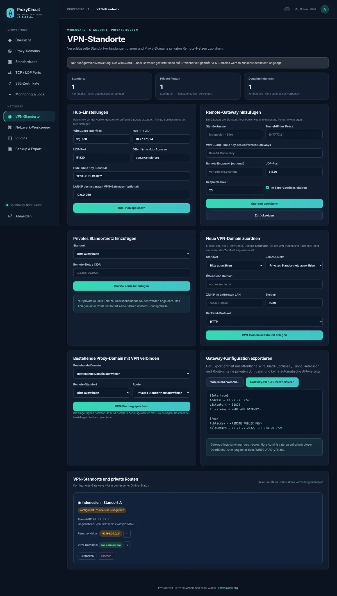
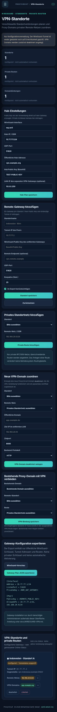

# Screenshots

Die Bilder in diesem Ordner wurden aus dem Frontend auf einem **simulierten Testsystem mit Demo-Domains** aufgenommen. Sie sind keine Bestätigung des Betriebs auf produktiven Servern.

| Datei | Inhalt |
| --- | --- |
| `domains.png` | Proxy-Domains: Kategorie-Tabs und kompakte Kacheln |
| `monitoring.png` | Monitoring: gruppierte Status-Kacheln |
| `default-page-editor.png` | HTML-Editor und Vorschau für die Standardseite |
| `mobile-domains.png` | Mobilansicht der Domain-Kacheln |
| `mobile-tabs.png` | Mobiles Kategorie-Menü |
| `mobile-default-editor.png` | Mobiler Standardseiten-Editor |

## WireGuard VPN (v0.2.4 Beta)

Die folgenden **synthetischen Vorschaudaten** zeigen das neue integrierte VPN-Modul; es handelt sich nicht um einen real verbundenen Standort.

